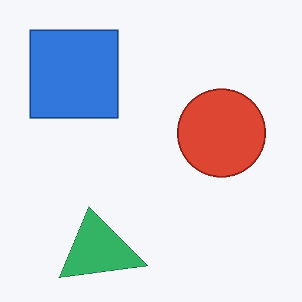
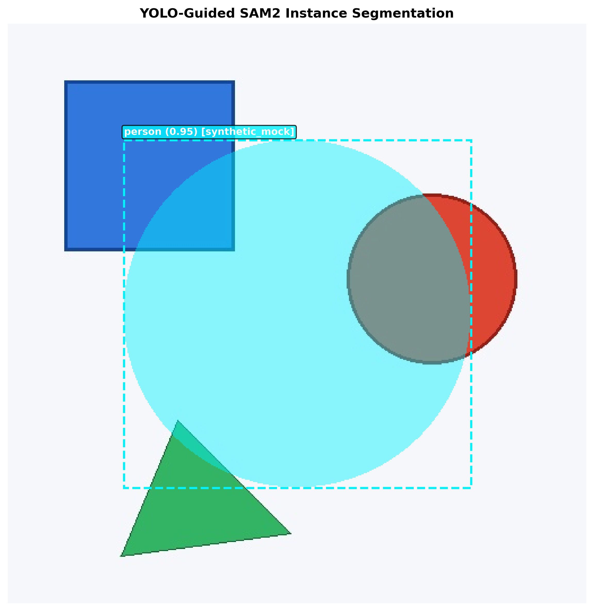
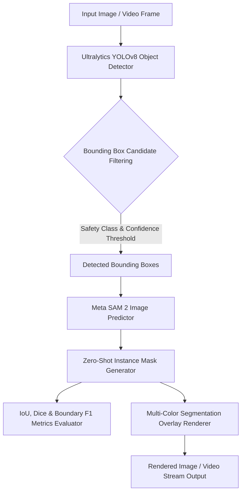

# YOLO-Guided SAM2 Zero-Shot Instance Segmentation Pipeline

[](https://github.com/shivangisrivastava013/SAM2-Image-Segmentation/actions/workflows/ci.yml)
[](https://www.python.org/downloads/)
[](https://pytorch.org/)
[](https://github.com/facebookresearch/segment-anything-2)
[](LICENSE)

A production-style computer vision pipeline combining real-time Ultralytics YOLOv8 object detections with Meta's Segment Anything Model 2 (SAM 2) for zero-shot promptable instance segmentation. Supports point, box, and automated 2-stage vision workflows with explicit mock-mode contract testing for CI.

## Demo & Artifact Links

- [Portfolio Project Page](https://shivangisrivastava013.github.io/shivangi-portfolio/#projects)
- [Benchmark Results (JSON)](results/evaluation_results.json)
- [Original Input Image](examples/input/sample.jpg)
- [YOLO-Guided Output Visualization](examples/output/yolo_guided_result.png)
- [Point-Prompt Output Visualization](examples/output/point_prompt_result.png)
- [Standalone CLI Demo](demo.py)

---

## Visual Before-and-After Pipeline Demonstration

The pipeline operates in two sequential stages: YOLOv8 detects bounding box regions and object classes, which are dynamically transformed into prompts for the SAM 2 mask decoder:

| Input Image (Original Sample) | YOLOv8 Detections & SAM 2 Instance Segmentation Masks |
| :---: | :---: |
|  |  |

---

## System Architecture



---

## Capabilities

1. **Automated Two-Stage Instance Segmentation**:
   - Executes real-time YOLOv8 object detection on candidate frames, extracts bounding boxes for target classes (`person`, `car`, `dog`, etc.), and feeds them to SAM 2 for pixel-precise zero-shot mask generation.

2. **Multi-Modal Prompting Interface**:
   - **Point Prompts**: Single or multi-point foreground/background coordinates (`predict_from_points`).
   - **Box Prompts**: Bounding box coordinate regions (`predict_from_box`).
   - **Combined Prompts**: Hybrid point and box guidance for refining complex object boundaries.

3. **Strict Checkpoint Integrity & Explicit Mock Mode**:
   - Missing SAM 2 weights trigger an explicit `RuntimeError` unless `--mock-mode` is deliberately enabled.
   - Prevents silent fallback masking or misleading synthetic evaluation reporting.

---

## Benchmark Validation

### Deterministic Mock-Mode Pipeline Validation (CI & Functional Verification)

*Purpose: Validates prompt coordinate transformations, bounding box parsing, IoU/Dice metric math, and overlay rendering on CPU runners in CI without requiring dedicated GPU hardware.*

Generated by running `python scripts/evaluate_dataset.py --mock-mode`:

| Validation Strategy | Mean IoU | Mean Dice | Boundary F1 | CPU Mock Latency | Mock Throughput |
| :--- | :---: | :---: | :---: | :---: | :---: |
| **Point-prompt SAM 2 (Mock)** | 0.7409 | 0.8512 | 0.1604 | 0.53 ms | 1903.7 FPS |
| **Box-prompt SAM 2 (Mock)** | 1.0000 | 1.0000 | 1.0000 | 0.45 ms | 2200.7 FPS |
| **YOLO-Guided SAM 2 (Mock)** | 0.5977 | 0.7482 | 0.0000 | 0.36 ms | 2810.6 FPS |

> [!NOTE]
> Mock-mode results validate prompt decoding, metric calculation, and overlay rendering pipelines deterministically. They do not represent inference results from trained SAM 2 neural network weights. Full GPU evaluation requires downloading official Meta checkpoints and executing on a CUDA-enabled GPU.

---

## Checkpoint Download & Setup Instructions

Meta's official SAM 2 checkpoints are hosted on FAIR's public AWS infrastructure. You can download checkpoints automatically using the bundled utility or directly via `curl` / `wget`.

### Option A: Download via Helper Script

```bash
# Download default SAM 2 Small checkpoint (175 MB)
python scripts/download_checkpoint.py --model sam2_hiera_small --output-dir checkpoints

# Or download other variants:
# python scripts/download_checkpoint.py --model sam2_hiera_tiny
# python scripts/download_checkpoint.py --model sam2_hiera_base_plus
# python scripts/download_checkpoint.py --model sam2_hiera_large
```

### Option B: Direct URL Download

| Model Variant | Parameters | File Size | Direct Download URL |
| :--- | :---: | :---: | :--- |
| `sam2_hiera_tiny` | 38.9M | 148 MB | [Download sam2_hiera_tiny.pt](https://dl.fbaipublicfiles.com/segment_anything_2/072824/sam2_hiera_tiny.pt) |
| `sam2_hiera_small` | 46.0M | 175 MB | [Download sam2_hiera_small.pt](https://dl.fbaipublicfiles.com/segment_anything_2/072824/sam2_hiera_small.pt) |
| `sam2_hiera_base_plus` | 80.8M | 308 MB | [Download sam2_hiera_base_plus.pt](https://dl.fbaipublicfiles.com/segment_anything_2/072824/sam2_hiera_base_plus.pt) |
| `sam2_hiera_large` | 224.4M | 856 MB | [Download sam2_hiera_large.pt](https://dl.fbaipublicfiles.com/segment_anything_2/072824/sam2_hiera_large.pt) |

```bash
# Example using curl:
mkdir -p checkpoints
curl -L https://dl.fbaipublicfiles.com/segment_anything_2/072824/sam2_hiera_small.pt -o checkpoints/sam2_hiera_small.pt
```

---

## Getting Started

### 1. Installation

```bash
git clone https://github.com/shivangisrivastava013/SAM2-Image-Segmentation.git
cd SAM2-Image-Segmentation

# Install core dependencies
pip install -r requirements.txt

# Install Meta's Segment Anything 2 package
pip install git+https://github.com/facebookresearch/segment-anything-2.git
```

### 2. Run Segmentation Workflows

```bash
# 1. Point prompt segmentation
python scripts/run_image.py --image examples/input/sample.jpg --prompt-type point --points 128 128

# 2. Bounding box prompt segmentation
python scripts/run_image.py --image examples/input/sample.jpg --prompt-type box --box 58 78 198 178

# 3. Automated YOLO-Guided SAM 2 segmentation
python scripts/run_image.py --image examples/input/sample.jpg --use-yolo

# 4. Run CLI demonstration
python demo.py
```

### 3. Run Benchmark Suite

```bash
# Run CPU mock validation suite (offline / CI)
python scripts/evaluate_dataset.py --mock-mode

# Run full evaluation with downloaded checkpoint
python scripts/evaluate_dataset.py --checkpoint checkpoints/sam2_hiera_small.pt
```

---

## Test Suite & Contract Verification

The repository maintains an extensive test suite verifying mathematical correctness, input contract validation, and error guards:

```bash
python -m pytest tests/ -v
```

All 13 unit tests pass in <7 seconds, covering:
- **`test_metrics.py`**: Mathematical validation of IoU, Dice coefficient, and Boundary F1 on perfect and disjoint masks.
- **`test_model_errors.py`**: Verification that missing checkpoints raise explicit exceptions and mock mode operates strictly on opt-in.
- **`test_prompt_validation.py`**: Validation of point and bounding box boundary coordinates.
- **`test_detector_contract.py`**: Schema adherence for YOLO detection payloads.
- **`test_pipeline.py`**: End-to-end integration of detector and mask generator.
- **`test_visualization.py`**: Multi-mask and bounding box overlay rendering.

---

## Docker Deployment

```bash
# Build Docker image
docker build -t sam2-image-segmentation:latest .

# Run containerized benchmark
docker run --rm sam2-image-segmentation:latest
```

---

## Repository Structure

```text
SAM2-Image-Segmentation/
├── demo.py                      # Interactive CLI demonstration
├── configs/
│   └── default.yaml            # Pipeline configuration
├── checkpoints/                 # SAM 2 model weights (.pt files)
├── examples/
│   ├── input/sample.jpg        # Input sample image
│   └── output/                 # Visual segmentation artifacts
│       ├── box_prompt_result.png
│       ├── point_prompt_result.png
│       └── yolo_guided_result.png
├── results/
│   └── evaluation_results.json # Structured benchmark metrics
├── sam2_pipeline/              # Core application package
│   ├── config.py               # YAML configuration parser
│   ├── evaluation.py           # IoU, Dice, Boundary F1 calculation
│   ├── pipeline.py             # YOLOGuidedSAM2Pipeline coordinator
│   ├── sam2_engine.py          # Meta SAM 2 image predictor interface
│   ├── schemas.py              # SegmentationResult & DetectionResult
│   ├── visualization.py        # Alpha-blended mask overlay renderer
│   └── yolo_detector.py        # Ultralytics YOLOv8 detector
├── scripts/
│   ├── download_checkpoint.py  # Checkpoint fetcher from Meta FAIR
│   ├── evaluate_dataset.py     # Benchmark evaluation runner
│   ├── run_image.py            # Single-image segmentation CLI
│   └── run_video.py            # Video stream segmentation CLI
└── tests/                      # Pytest unit & contract test suite
```

---

## License

Distributed under the [MIT License](LICENSE).
